# Mortgage Underwriting Multi-Agent System

A portfolio demonstration of an explainable, policy-grounded mortgage underwriting workflow built with LangGraph and LangChain.

The notebook coordinates specialist agents for credit, income, assets, and collateral; a critic reviews their work; a decision agent produces a recommendation; and higher-risk cases can be routed to a human reviewer.

> **Portfolio and educational use only.** This project uses synthetic applicant data and simplified, synthetic policies. It is not a production lending system and must not be used to make real credit decisions.



## What this project demonstrates

- **Multi-agent orchestration:** specialist, critic, and decision agents coordinated through a LangGraph state machine
- **Retrieval-augmented generation:** underwriting guidance retrieved from a local Chroma vector store
- **Deterministic calculations:** DTI, LTV, reserves, housing expense, and debt calculations are performed with tools rather than delegated to an LLM
- **Privacy-aware processing:** PII sanitization before data reaches analysis agents
- **Responsible AI controls:** bias-signal checks, policy-violation tracking, an audit trail, and human-in-the-loop review
- **Scenario-based evaluation:** synthetic approval, conditional-approval, and rejection cases

## Agent workflow

1. Sanitize applicant PII.
2. Retrieve relevant policy context.
3. Run specialist analysis:
   - Credit Analyst
   - Income Analyst
   - Asset Analyst
   - Collateral Analyst
4. Review findings with the Critic Agent.
5. Produce a recommendation with the Decision Agent.
6. Route higher-risk cases to a human reviewer.

## Repository structure

```text
.
|-- data/
|   |-- synthetic_mortgage_test_cases.json
|   `-- synthetic_underwriting_policies.md
|-- docs/
|   `-- architecture.svg
|-- notebooks/
|   `-- mortgage_underwriting_multi_agent_system.ipynb
|-- scripts/
|   |-- check_public_repo.py
|   `-- prepare_notebook.py
|-- .env.example
|-- .gitignore
|-- LICENSE
`-- requirements.txt
```

## Quick start

### 1. Create a virtual environment

```bash
python -m venv .venv
```

Activate it:

```bash
# Windows PowerShell
.\.venv\Scripts\Activate.ps1

# macOS/Linux
source .venv/bin/activate
```

### 2. Install dependencies

```bash
python -m pip install --upgrade pip
python -m pip install -r requirements.txt
```

### 3. Configure the model provider

Copy `.env.example` to `.env`, then add your API key:

```bash
copy .env.example .env
```

For the standard OpenAI API, leave `OPENAI_BASE_URL` blank. For another OpenAI-compatible provider, set its base URL.

### 4. Run the notebook

```bash
jupyter lab notebooks/mortgage_underwriting_multi_agent_system.ipynb
```

Run cells from top to bottom. The first model call and vector-store creation require network access and may incur provider charges.

## Test scenarios

The included dataset contains three fictional applicants designed to exercise distinct workflow paths:

| Scenario | Expected outcome | Primary signals |
|---|---|---|
| Strong profile | Approved | Strong credit, stable income, adequate reserves |
| Marginal profile | Conditional | Moderate DTI, short job tenure, repair conditions |
| High-risk profile | Rejected | Recent bankruptcy, high DTI, insufficient documented funds |

Names, contact details, account information, and financial histories are fabricated. They do not describe real people.

## Design notes

- The LLM provides qualitative analysis; deterministic tools calculate financial ratios.
- Retrieved policy excerpts are injected into each specialist prompt.
- The shared `UnderwritingState` records specialist outputs, compliance flags, routing state, and the reasoning audit trail.
- Human review is represented with notebook widgets for demonstration purposes.

## Limitations and responsible-use boundaries

- The synthetic policy file is intentionally simplified and is not an authoritative underwriting guide.
- LLM output can be incorrect, inconsistent, or biased even with guardrails.
- The bias detector is a demonstration control, not a complete fair-lending compliance program.
- Production use would require validated policy rules, model-risk governance, adverse-action logic, security controls, monitoring, accessibility testing, and legal/compliance review.
- Never send real applicant PII to this notebook or an external model provider.

## Public-repository safety check

Before publishing, run:

```bash
python scripts/check_public_repo.py
```

The check fails if it finds notebook outputs, common secret patterns, a committed `.env`, or the legacy `config.json` credential file.

## License

Code and original documentation are available under the [MIT License](LICENSE).

